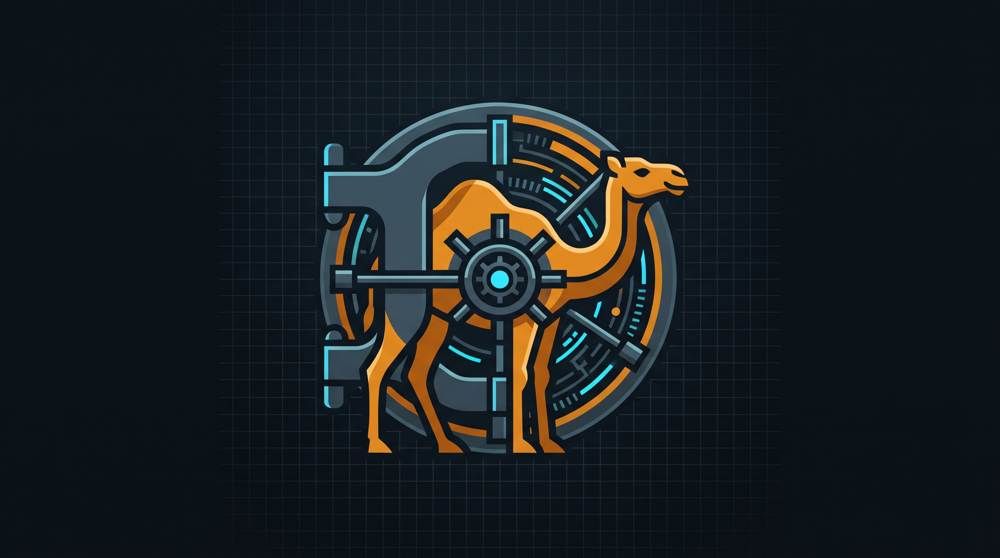

# `@rmk-systems/camel-symbolic-airlock`

**Zero-Trust Symbolic Ambiguity Trap & Cryptographic Capability Provenance for Model Context Protocol (MCP) Agents.**

[](https://www.typescriptlang.org/)
[](https://modelcontextprotocol.io)
[](#)
[](./LICENSE)

---

## Why This Exists: The Polysemy & Boundary Problem

<div align="center">
  
</div>

When someone writes a prompt like \"clean the staging directory\", \"optimize the workflow\", or \"collaborate with other models to achieve X\", the model does not decide what it wants to do. It produces output that statistically fits the request. 

Because ordinary human words are overloaded symbols with thousands of conflicting meanings across a model's training weights, a model has no shared context for which specific meaning you intended. If the prompt—or the tool permissions wrapped around it—is broad, ambiguous, or missing constraints, the model picks a statistically likely path that the human never pictured.

Most AI security frameworks only defend against **external adversaries** (prompt injections hidden in untrusted data). They still blindly trust the human's initial natural language prompt to define the control flow.

**`@rmk-systems/camel-symbolic-airlock`** solves both halves of the problem by placing a two-stage deterministic airlock between human language and MCP tool execution:

1. **Layer 1: The Symbolic Ambiguity Trap (Upstream Lexical Grounding)**  
   Treats natural language polysemy as a **compile-time type error**. Overloaded verbs (\"clean\", \"fix\", \"sync\", \"purge\") or missing numeric boundaries force the zero-permission compiler into a `HALT_AMBIGUOUS_SYMBOL` union branch, suspending execution and rendering strict UI Enum buttons and clamped sliders—resolving intent with **zero second-pass LLM calls**.
2. **Layer 2: Distributed CaMeL Provenance Engine (Downstream Data-Flow Isolation)**  
   Extends Google DeepMind's **CaMeL (CApabilities for MachinE Learning)** framework across stateless microservices and MCP servers using **Ed25519 cryptographic envelopes** and **monotonic taint propagation**.

---

## Installation

```bash
npm install @rmk-systems/camel-symbolic-airlock zod zod-to-json-schema
```

Package entrypoints are cleanly isolated so browser bundles never pull in `node:crypto` or server SDKs:

- `@rmk-systems/camel-symbolic-airlock/server` — Ed25519 authority, taint-merger, and MCP server interceptors.
- `@rmk-systems/camel-symbolic-airlock/react` — Headless state machine hook (`useCaMeLMcpAirlock`) and UI controller.

---

## License

MIT © Bonnie Remeika ([rmk.systems](https://rmk.systems))
